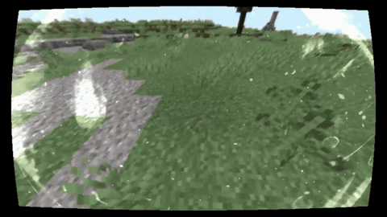
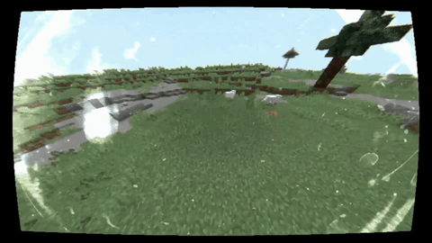
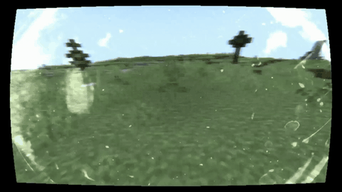
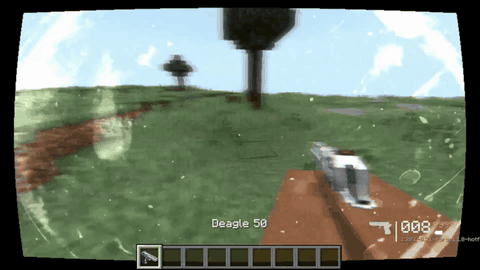

<div align="center">

# 📹 NEXUS Bodycam

**Turn Minecraft into a first-person bodycam experience.**
Chest-mounted camera, breathing you can hear, lens effects and full weapon realism.

`Minecraft 1.20.1` · `Fabric` · `Client-side` · `v1.4.3+1.20.1`

[](LICENSE)
[](https://fabricmc.net/game/version/1.20.1/)
[](https://fabricmc.net/use/)
[](https://openjdk.org/)
[](AI-TRANSPARENCY.md)

[Install](#installation) · [Build](#building-from-source) · [Configuration](#configuration) · [Wiki](../../wiki) · [Issues](../../issues) · [AI disclosure](AI-TRANSPARENCY.md)

</div>

---

## Preview

| | |
|---|---|
|  |  |
| **Smooth steps** — audio-synced bob + step damping | **Flying shake** — the camera shakes hard while you fly |
|  |  |
| **Real roll** — true banking, angular motion blur | **TACZ gun spring** — recoil, sway, lowering |

---

## What it does

NEXUS Bodycam is a **pure client-side camera overhaul**: it changes how the camera *feels and looks* — never movement speed, hitboxes, raycasts or server logic.

### 🦶 Camera motion
- **Audio-synced footsteps** — one bounce per footstep, locked to Minecraft's own step sounds (no guess-timer).
- **Step smoothing & landing damping** — a vertical spring eats stairs, slabs and jumps.
- **Rotational landing jolt** — big falls kick pitch and roll proportionally.
- **Realistic head bob** — cosine-based, phase-locked (vanilla bobbing can be disabled).
- **Idle micro-tremor** — Perlin noise + 8 Hz GoPro-style vibration that scales with movement.
- **Sprint/strafe lean & yaw inertia** — the view lags your mouse slightly, like a device on a vest.
- **True roll** — injected into the world render matrix (±10°), not a fake rotation.
- **Chest camera mode** — camera dropped to chest height, pitch tilt, wide-FOV multiplier.

### 🫁 Breathing system
- **Synchronized breath audio** — 3.06 s cycle, exhale at the exact midpoint, matched to the included OGG.
- **Asymmetric shape** — quick inhale, smooth exhale, Perlin irregularity.
- **Sprint exhaustion** — +35 % after 5 s, up to +65 % after 20 s; volume and pitch rise, resets when you stop.

### 💥 Damage & impact
- Damage shake scaled to the hit, landing spring (pitch + alternating per-foot roll), impact recovery sequence.

### 🔧 Post-processing lens pipeline
Fisheye (K1/K2) · wide-FOV multiplier · radial chromatic aberration · dual vignette · lens dirt/veiling glare · film grain (quantized at ~30 fps) · 17-tap depth of field for the config menu · auto exposure · flash shock · lens contamination · angular motion blur · volumetric dust · low-light sensor noise.

### 🌊 Realistic water
Surface waves, procedural caustics, foam, refraction, underwater fog + RGB tint.

### 🔫 TACZ integration *(optional)*
Visual-only gun realism — **never** touches raycasts, bullets or sights: second-order gun spring with overshoot, weapon lowering, run sway, recoil kick, global view smoothing. Without TACZ the mixins disable themselves automatically.

### 🎨 Shader compatibility
Designed to work *with* bodycam shaderpacks: the mod owns the **camera motion**, the shader owns the **lens look**. "Sync with Shader" reduces shake/bob when Iris detects a shaderpack, and shadow passes are skipped so post-FX never corrupts them.

### 🎛 8 presets
`Subtle` · `Normal` · `Intense` · `EXTREME` · `Documentary` · `Horror` · `Tactical` · `Raw GoPro`

---

## Installation

📥 **Download:** [**latest release**](../../releases/latest) → `NEXUS-bodycam-1.4.3+1.20.1.jar`

1. Install **[Fabric Loader](https://fabricmc.net/use/installer/)** for Minecraft **1.20.1**.
2. Drop `NEXUS-bodycam-1.4.3+1.20.1.jar` into your `mods` folder.
3. *(Optional)* **[Mod Menu](https://modrinth.com/mod/modmenu)** for the in-game config screen, **[TACZ](https://modrinth.com/mod/tacz)** for weapon realism, **[Iris](https://modrinth.com/mod/iris)** for shaders.

**Requirements:** Fabric Loader ≥ 0.15.11 · Fabric API · Java 17+.
Full walkthrough (with troubleshooting): **[Installation Wiki page](../../wiki/Installation)**.

---

## Building from source

```bash
git clone https://github.com/jhfuheuiwfh/nexus-bodycam-mod.git
cd nexus-bodycam-mod
```

1. **JDK 17 or 21** on `JAVA_HOME` (any modern JDK works — it compiles targeting Java 17).
2. Put the **TACZ jar in `libs/`** — it is a third-party binary, so it is *not* in this repo (see [`libs/README.md`](libs/README.md)).
3. Build:

```bash
./gradlew build          # Windows: gradlew.bat build
```

The result is `build/libs/NEXUS-bodycam-1.4.3+1.20.1.jar`.
More detail: **[Building Wiki page](../../wiki/Building)**.

---

## Configuration

Open **Mod Menu → NEXUS Bodycam → Settings**. The screen scrolls and is organized in categories:

| Category | Options |
|---|---|
| Smoothing | step smoothing, landing damping, view smoothing |
| Shaking | idle shake amount & frequency |
| Bobbing | amount, frequency, roll lean |
| Weapon & View | TACZ spring, lowering, run sway, recoil, view smooth |
| Camera | chest camera, height, pitch, wide FOV |
| Post-FX | fisheye K1/K2, vignette, chromatic aberration, lens dirt, grain |
| Water | waves, caustics, refraction, underwater fog & tint |
| Compatibility | sync with shader, disable vanilla bobbing |

Settings are saved to `config/bodycam.json` with validation — invalid or missing values fall back to safe defaults.

---

## Compatibility

| Mod | Status |
|---|---|
| Fabric API | **Required** |
| Mod Menu | Optional — config screen |
| TACZ | Optional — weapon realism |
| Iris / Sodium | Compatible (shadow-pass guarded) |
| Bodycam-style shaderpacks | Compatible (*Sync with Shader*) |
| Distant Horizons | Compatible |

**Performance** (measured with every Post-FX enabled, 32-chunk render/simulation distance): **75–83 FPS avg** on a Ryzen 5 5600X + RX 580 8 GB + 16 GB DDR4.

---

## Project layout

```
├── src/main/java/dev/bodycam/   # camera, effects, config, GUI, mixins
├── src/main/resources/          # shaders (post, dofblur), sounds, textures, lang
├── sounds/  textures/           # source assets (WAV master, art originals)
├── libs/                        # local third-party jars (git-ignored)
├── docs/                        # CHANGELOG.md · DEVNOTES.md
├── TODO.md                      # roadmap & pending work
├── AI-TRANSPARENCY.md           # how AI was used in this project
└── MODRINTH.md                  # Modrinth store description
```

---

## 🤖 AI transparency

This project is **substantially AI-generated** and says so openly: a large share of the
**code, shaders, assets and documentation** was produced by AI coding agents
(OpenCode sessions), with the human author directing the work, testing in-game and
making the final calls. Some of the code was written from scratch and **modified by
hand** by the author, so the codebase is a mix of AI and human work.

Full details — what AI did, what the human did — are in **[AI-TRANSPARENCY.md](AI-TRANSPARENCY.md)**.
The same disclosure is used on the Modrinth page (content rating → *Contains AI-generated content*).

---

## License

Released under the **[GNU General Public License v3.0](LICENSE)**.

Minecraft is a trademark of Mojang Studios. This project is not affiliated with Mojang.
TACZ, Mod Menu, Iris and Sodium belong to their respective authors.

**Links:** [Repository](../../) · [Issue tracker](../../issues) · [Wiki](../../wiki) · [Changelog](docs/CHANGELOG.md) · [Dev notes](docs/DEVNOTES.md)
